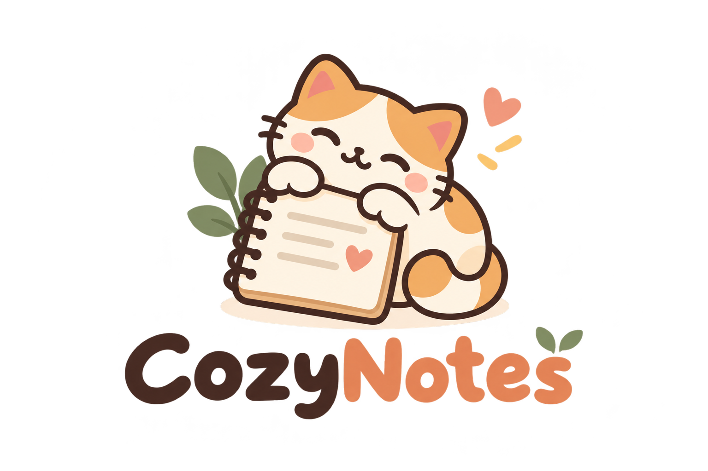

<p align="center">
  
</p>

<h1 align="center">CozyNotes</h1>

<p align="center">
  <strong>A little home for your notes.</strong><br />
  Small reminders, everyday lists, and thoughts worth keeping.
</p>

CozyNotes is a quiet desktop notes app with soft paper colors and a cozy place to write. Keep a note beside your work, find an old idea in your library, or tick off a little list. Your notes stay on your device, and the app works offline without an account. Fonts are bundled locally, too.

## Make yourself at home

- **Room to think.** Open notes in their own windows and let autosave take care of your writing.
- **A little structure.** Use rich text, bullet lists, and checklists. Reset completed items when a list needs a fresh start.
- **Find things again.** Search your library, filter by paper color, or find a word inside a note.
- **Pick your paper.** Choose Cream, Butter, Sage, Rose, Lavender, or Mist.
- **Set the mood.** Open Settings to choose Warm, Night, or System. Your preference is remembered and shared across open windows.
- **Stay within reach.** Use the CozyNotes icon in the system tray to open a note, show the main menu, or exit. Run in background is enabled by default and can be changed in Settings.
- **Keep a note visible.** Use **Keep on top** in a note toolbar to keep that note above ordinary windows while you work elsewhere. The setting belongs to the current note window, resets when that window is closed, and is unavailable on Linux Wayland sessions.
- **Tidy up together.** Select the circles beside notes to move several to Trash. Select all applies to the notes in your current search and paper-color filter.
- **Keep what matters.** Duplicate a useful note or restore one from Trash before deleting it for good.

## Settle in

Create a note from the library and start writing. Drag the library by its heading or branding; drag a note using empty space along its toolbar or footer. Closing a note saves it and keeps it in your library.

With Run in background enabled, closing the main window keeps CozyNotes available from its icon beside the Windows clock. Right-click that icon for **Notes**, **Show main menu**, and **Exit CozyNotes**. Exit waits for open drafts to save; if a draft cannot save, it stays open for recovery.

The **Settings** button in the sidebar opens appearance and background preferences in the right pane. Both preferences are remembered. Turn off Run in background to exit normally when the last window closes.

Select a note using its circle without opening it. The selection bar shows the count and provides **Select all**, **Clear selection**, and **Move to Trash**. In Trash, **Delete selected** asks for confirmation before permanently deleting the selection. Changing the search, paper-color filter, or page clears the selection.

Use `Ctrl` on Windows/Linux or `Cmd` on macOS:

| Shortcut | A little help |
| --- | --- |
| Ctrl/Cmd + N | New note |
| Ctrl/Cmd + W | Close the current note |
| Ctrl/Cmd + F | Find in a note, or search from the library |
| Ctrl/Cmd + Shift + F | Open library search from a note |
| Ctrl/Cmd + + / - | Adjust note reading size |
| Ctrl/Cmd + 0 | Reset note reading size |

## Growing gently

CozyNotes is in early development, currently **0.1.5**. Download the app from [GitHub Releases](https://github.com/JayM3/CozyNotes/releases/latest):

| Platform | Download |
| --- | --- |
| Windows x64 | `Cozynote.exe` to run directly, or the `windows_x64_setup.exe` installer |
| macOS Apple Silicon | `macos_aarch64.dmg` |
| macOS Intel | `macos_x64.dmg` |
| Linux x64 | `linux_x64.AppImage` or `linux_x64.deb` |

The Windows executable requires WebView2 Runtime, which the installer can install when needed. Linux packages are built on Ubuntu 22.04 and require WebKitGTK 4.1; the Debian package declares its runtime dependencies. For AppImage, make the file executable before opening it.

Windows and macOS downloads are not signed with publisher certificates, and macOS builds are not notarized. Windows has received local desktop testing; macOS and Linux still need native interaction testing. Release builds and automated checks run on GitHub Actions for all three platforms. Each release includes `SHA256SUMS.txt` for checking downloaded files.

Image attachments, remembered window arrangements, user-facing backup and restore, and exports are still on the wish list. You can also build the app from source using the steps below.

## Run it locally

Built with Tauri 2, React, TypeScript, and Rust. Use Node.js **24.15.0 or a newer 24.x release**, npm, stable Rust, and the native prerequisites for your platform:

- **Windows:** Microsoft C++ Build Tools with the Desktop development with C++ workload, the Windows SDK, WebView2 Runtime, and the MSVC Rust toolchain.
- **macOS:** Xcode Command Line Tools.
- **Linux:** WebKitGTK 4.1 and the native build dependencies. On Debian/Ubuntu:

  ```sh
  sudo apt-get update
  sudo apt-get install -y build-essential curl wget file libwebkit2gtk-4.1-dev \
    libxdo-dev libssl-dev libayatana-appindicator3-dev librsvg2-dev
  ```

From the repository root:

```sh
npm ci
npm run tauri dev
```

`npm run dev` opens the frontend alone. Saving notes and managing desktop windows require the Tauri runtime.

<details>
<summary>Builds, checks, and Windows network shares</summary>

Run the automated checks:

```sh
npm test
npm run build
cargo fmt --manifest-path src-tauri/Cargo.toml -- --check
cargo test --locked --manifest-path src-tauri/Cargo.toml
```

Build a desktop executable with `npm run tauri build -- --no-bundle`, or create platform-specific installers with `npm run tauri build`.

To publish a release, synchronize the versions in `package.json`, `package-lock.json`, `src-tauri/Cargo.toml`, `src-tauri/Cargo.lock`, and `src-tauri/tauri.conf.json`; add `docs/releases/v<VERSION>.md`; then push the matching `v<VERSION>` tag after CI passes. The release workflow tests and builds Windows x64, both macOS architectures, and Linux x64, then publishes the complete set of downloads.

Build output goes to `src-tauri/target/` (or `CARGO_TARGET_DIR` when set). Executables are under `release/`; installers are under `release/bundle/`. Keep copies of packaged builds and other release files in the local **`releases/`** folder at the repository root. That folder and everything inside it are ignored by Git.

On Windows, a local checkout is easiest. For an SMB/UNC checkout, map the repository to a drive and run commands there. Keep Rust build output on a local disk:

```powershell
$env:CARGO_TARGET_DIR = "$env:TEMP\cozynotes-target"
npm run tauri dev
```

See the [tray, Settings, and selection verification record](docs/2026-10-17-settings-tray-selection-verification.md) for this feature's checks, and the [Everyday Use verification record](docs/everyday-use-verification.md) for earlier desktop checks and search measurements. Automated checks do not replace native interaction or installer testing.

See the [Keep on top research and verification record](docs/2026-10-18-keep-on-top.md) for the native API decision, platform behavior, and Windows runtime checks.

</details>

## Your notes live here

Notes are stored in `data/cozynotes.sqlite` inside Tauri's per-user app-local-data directory for `com.cozynotes.app`, separate from the project folder. Existing libraries receive a safety snapshot in a sibling `recovery/` directory before a database migration. These snapshots are separate from the planned user-facing backup feature.

For isolated desktop testing, debug builds accept an absolute local `COZYNOTES_TEST_DATA_DIR`; release builds ignore it. Keep personal notes, databases, and private screenshots out of commits and issue reports.

## Lend a hand

Bug reports, small improvements, and thoughtful ideas are welcome. Start with [CONTRIBUTING.md](CONTRIBUTING.md). The [design notes](design.md) describe the colors, typography, and quiet interactions that make CozyNotes feel like home.

Made available under the [MIT License](LICENSE). Bundled fonts and dependencies keep their own licenses; see [third-party notices](THIRD_PARTY_NOTICES.md).
